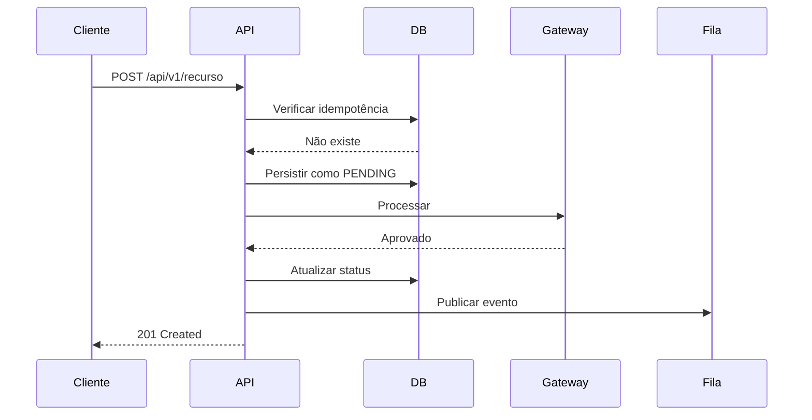

# plan.md — [Nome do Projeto ou Feature]

<!--
Este arquivo responde: "Como vai ser construído?"

É a tradução das decisões técnicas específicas desta feature.
O que já está nos `playbooks/` NÃO deve ser repetido aqui — apenas referenciado.
Este arquivo documenta apenas o que é ÚNICO e ESPECÍFICO deste projeto.

Estrutura de cada decisão:
  1. O que foi decidido
  2. Por que (rationale)
  3. Alternativas consideradas e por que foram descartadas
  4. Consequências e trade-offs

Por que documentar as alternativas rejeitadas?
  - Evita que o agente "redescubra" e implemente uma alternativa descartada
  - Evita que um novo dev reabra discussões já resolvidas
  - Cria trilha de auditoria das decisões arquiteturais
-->

---

## Referências

<!--
Liste os patterns e documentos que este plano estende.
Não repita o conteúdo deles — apenas referencie.
-->

- [[microservice]]   — estrutura de pastas, comunicação, resiliência, deploy
- [[rest-api]]       — contratos HTTP, envelope, autenticação
- [[requirements]]   — o que precisa ser implementado
- [[contracts]]      — o que precisa ser construído

---

## Fluxo principal

<!--
Diagrama ou descrição passo a passo do fluxo crítico da feature.
Seja explícito sobre a ORDEM das operações — isso evita bugs de sequência.

Use Mermaid para fluxos complexos:



Ou lista ordenada se o fluxo for linear:
-->

**Ordem das operações — [nome do fluxo principal]:**

1. [Passo 1 — ex: Validar input e autorização]
2. [Passo 2 — ex: Verificar idempotência]
3. [Passo 3 — ex: Persistir estado inicial]
4. [Passo 4 — ex: Chamar serviço externo com retry]
5. [Passo 5 — ex: Atualizar estado conforme resposta]
6. [Passo 6 — ex: Emitir evento de resultado]

<!--
IMPORTANTE: documente invariantes de ordem se existirem.
Exemplos:
- "O evento NUNCA é emitido antes da atualização do banco."
- "O estado inicial é sempre PENDING — nunca pulamos para APPROVED diretamente."
-->

---

## Decisões técnicas

<!--
Para cada decisão que não está coberta pelos patterns, use o formato abaixo.
Seja direto: o agente vai implementar exatamente o que estiver aqui.

Formato recomendado por decisão:
  **[Nome da decisão]**
  Decisão: [o que foi escolhido]
  Rationale: [por que]
  Alternativas descartadas: [o que foi considerado e por que não foi escolhido]
  Consequências: [trade-offs, limitações, o que essa decisão implica]
-->

**[Decisão 1 — ex: Banco de dados]**
Decisão: [ex: PostgreSQL via Prisma. Variável `DATABASE_URL` via Parameter Store.]
Rationale: [ex: Consistência ACID necessária para transações de pagamento. Prisma escolhido por type-safety.]
Alternativas descartadas: [ex: MongoDB — descartado por falta de suporte nativo a transações multi-document no time.]
Consequências: [ex: Migrações via `prisma migrate` — necessário rodar no deploy. Schema type-safe mas migrations irreversíveis em produção.]

---

**[Decisão 2 — ex: Estratégia de idempotência]**
Decisão: [ex: Verificação na camada application via campo `idempotencyKey` com constraint unique no banco.]
Rationale: [ex: Garante idempotência mesmo com múltiplas instâncias rodando em paralelo — o banco é a fonte de verdade.]
Alternativas descartadas: [ex: Cache Redis — descartado por adicionar dependência de infraestrutura e risco de expiração prematura.]
Consequências: [ex: Segunda requisição com mesmo key retorna o registro existente sem reprocessar. Chave nunca expira — implementar cleanup se necessário.]

---

**[Decisão 3 — ex: Publicação de eventos]**
Decisão: [ex: AWS SQS via SDK. Fila configurada via `QUEUE_URL`. DLQ no Terraform.]
Rationale: [ex: Falha na publicação não deve reverter o pagamento — SQS com DLQ garante entrega eventual sem afetar a transação principal.]
Alternativas descartadas: [ex: Publicação dentro da transação de banco — descartado por acoplar banco e fila, aumentando latência e risco de timeout.]
Consequências: [ex: Possível janela de inconsistência entre banco e fila. DLQ precisa ser monitorada. Falha na publicação é logada mas não propaga erro ao cliente.]

---

**[Decisão N]**
Decisão: [...]
Rationale: [...]
Alternativas descartadas: [...]
Consequências: [...]

<!--
Se uma decisão se repetir em outro projeto, anote para promover ao pattern:
"Quando este padrão se repetir em outro projeto, promover para playbooks/[nome].md via ADR."
-->

---

## Variáveis de ambiente

<!--
Liste todas as variáveis de ambiente necessárias.
NUNCA valores hardcoded — apenas o nome e de onde vêm.
-->

| Variável | Descrição | Fonte em produção |
|---|---|---|
| `[NOME_DA_VAR]` | [para que serve] | AWS Parameter Store |
| `[OUTRA_VAR]` | [para que serve] | AWS Secrets Manager |
| `DATABASE_URL` | Connection string do banco | AWS Parameter Store |

---

## Estrutura de pastas

<!--
Mostre onde cada peça vai dentro da estrutura do [[microservice]] (ou pattern aplicável).
Isso elimina ambiguidade sobre onde o agente deve criar cada arquivo.
Remova esta seção se a estrutura for 100% padrão sem nenhuma particularidade.
-->

```
src/
├── application/
│   └── use-cases/
│       ├── [NomeDoUseCase].ts         ← [descreva responsabilidade]
│       └── [OutroUseCase].ts
├── domain/
│   ├── [Entidade].ts                  ← [tipos e interfaces de domínio]
│   ├── [Entidade]Repository.ts        ← [interface do repositório]
│   └── errors.ts                      ← [erros de domínio tipados]
├── infrastructure/
│   ├── database/
│   │   ├── Prisma[Entidade]Repository.ts
│   │   └── prisma/schema.prisma
│   ├── [integracaoExterna]/
│   │   └── [IntegracaoClient].ts
│   └── events/
│       └── EventPublisher.ts
└── interface/
    ├── controllers/
    │   └── [Entidade]Controller.ts
    ├── routes/
    │   └── [entidade]Routes.ts
    └── middleware/
        ├── errorHandler.ts
        └── requestLogger.ts
```
