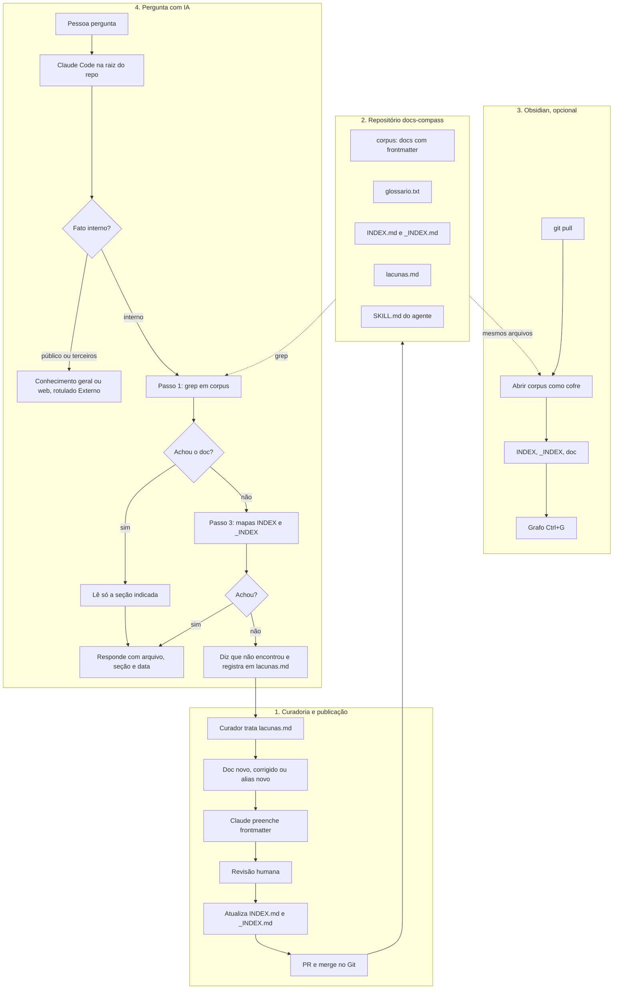

# Registro de decisões do docs-compass

Para cada decisão: o contexto, o que foi decidido, as alternativas, **por quê** (com a evidência) e as consequências. O estado de cada uma está marcado, porque nem tudo foi validado do mesmo jeito.

**Legenda de estado:** **Decidido** · **Provisório** (vale por ora, pode mudar) · **Em aberto**.
**Legenda de evidência:** *Simulação* = teste em código (seção 5 e 6 do [RELATORIO.md](RELATORIO.md)); *Agentes* = teste com agentes Claude reais ([TESTE-AGENTES.md](TESTE-AGENTES.md)). Ambos foram feitos em **120 docs inventados**, nenhum em docs reais.

## Diagrama do fluxo

Arquivo: [diagramas/fluxo-docs-compass.drawio](diagramas/fluxo-docs-compass.drawio). Abra no [app.diagrams.net](https://app.diagrams.net) (Arquivo > Abrir) ou na extensão Draw.io Integration do VS Code. Não renderizei o diagrama visualmente aqui; conferi só que o arquivo é válido e que as caixas não se sobrepõem.

Ele tem 4 raias: **1) Curadoria e publicação**, **2) Repositório no Git**, **3) Leitura humana no Obsidian** e **4) Pergunta com IA**. O Obsidian e o agente leem a mesma pasta; não há conexão direta entre eles.

Versão em texto do mesmo fluxo (o Obsidian e o GitHub desenham este bloco sem plugin):

## Índice

| # | Decisão | Estado |
|---|---|---|
| D1 | Um repositório único em Git | Decidido |
| D2 | Sem embeddings, sem API, sem servidor | Decidido |
| D3 | Frontmatter enriquecido em todo doc | Decidido |
| D4 | Indexar por seção, não por arquivo | Decidido (validado só em simulação) |
| D5 | Glossário de sinônimos e ciclo de lacunas | Decidido |
| D6 | Mapas hierárquicos (INDEX e _INDEX) gerados | Decidido; geração pendente |
| D7 | Busca primeiro, mapas de reserva | Decidido |
| D8 | A skill é um roteador, não um catálogo | Decidido (disparo real não testado) |
| D9 | Não bloquear a internet; regra de fontes e citação | Decidido |
| D10 | Grep como caminho principal; script opcional | Provisório |
| D11 | Obsidian só para ler, sem conexão com o agente | Decidido |
| D12 | Curadoria faz parte do produto | Decidido; automação pendente |
| D13 | Validar em duas etapas: simulação e agentes reais | Parcial |
| D14 | PowerShell como linguagem das ferramentas | Provisório |
| D15 | "For future agent", `confidence` e skill que só propõe gravações | Decidido |

---

## D1. Um repositório único em Git

**Contexto.** O conhecimento estava com uma pessoa e em arquivos soltos; o time perguntava a ela. Era preciso escolher entre centralizar ou distribuir cópias.

**Decisão.** Um repositório `docs-compass`, versionado, com revisão por pull request. Cada pessoa clona e atualiza com `git pull`.

**Alternativas.** (a) Arquivo compactado enviado ao time; (b) wiki fora do Git (Confluence, Notion); (c) cada equipe mantendo a sua cópia.

**Por quê.** Há uma só fonte da verdade, com histórico e revisão. Distribuir um zip desatualiza na primeira mudança. E a mesma pasta serve ao agente de IA e ao Obsidian, sem sincronização entre eles.

**Consequências.** Exige donos por domínio e um processo de PR (ver D12). Quem não usa Git precisa de apoio. O repositório real ainda **não foi criado**: o que existe é o exemplo desta pasta.

## D2. Sem embeddings, sem API, sem servidor

**Contexto.** Restrição do pedido: subir API ou serviço seria custoso, e vetorização estava descartada como base.

**Decisão.** Recuperação por texto (grep, busca por palavras e mapas), sem vetores e sem serviço.

**Alternativas.** RAG com banco vetorial; API de embeddings; serviço FastAPI.

**Por quê.** Cumpre a restrição. A evidência é que, em 120 docs, a abordagem sem vetores chegou a **97,2% na simulação** e a **12 de 12 respostas corretas** nos agentes reais. O que substitui os vetores é vocabulário explícito: aliases no cabeçalho de cada doc e o glossário (D3, D5).

**Consequências.** Depende de curadoria de vocabulário. Há um limite de escala, tratado só como análise (seção 17 do relatório): as faixas lá são estimativas, não medições. Os sinais para reavaliar estão no mesmo lugar.

## D3. Frontmatter enriquecido em todo doc

**Contexto.** A IA precisa saber do que o doc trata, e a resposta pode estar no fim do arquivo, sob um título que não diz isso.

**Decisão.** Todo doc tem `id`, `title` (no formato `Tópico - Aspecto`), `dominio`, `topico`, `resumo`, `aliases`, `perguntas`, `owner`, `atualizado`. O `resumo` deve citar o que há no fim do doc.

**Alternativas.** Melhorar só os títulos; ler o corpo inteiro dos docs; depender do conteúdo sem metadados.

**Por quê.** Na simulação, sem o cabeçalho (docs legados) os docs de título genérico caíram para **45%**, e o glossário plano de títulos acertou **0%** nesses casos. Quem escreve o resumo (o Claude, em lote) leu o doc inteiro.

**Consequências.** Há um trabalho único de enriquecer os docs existentes e um trabalho contínuo de manter. O Claude pode errar o resumo, então precisa de revisão humana. Cada campo fica em **uma linha** (a busca lê linha a linha). Regras completas em [CURADORIA.md](../CURADORIA.md).

## D4. Indexar por seção, não por arquivo

**Contexto.** Abrir o arquivo inteiro custa tokens e esconde a resposta do fim do doc.

**Decisão.** A busca por seção (`DocSearch.ps1`) divide cada doc em blocos `##` e devolve as melhores seções, com o cabeçalho do doc como contexto.

**Alternativas.** Busca por arquivo (S4 e S4g da simulação).

**Por quê.** Na simulação, o custo caiu de ~1.629 para ~534 tokens por pergunta com acerto parecido (82,8% e 84%).

**Consequências.** Exige títulos `##` e docs de tamanho razoável (ver análise de arquivos grandes, seção 17.2). **Validação parcial:** o script de busca **nunca rodou nos agentes reais** (D10), então o ganho só está comprovado na simulação.

## D5. Glossário de sinônimos e ciclo de lacunas

**Contexto.** As pessoas perguntam com as palavras delas ("teto"), não com as dos docs ("limite máximo").

**Decisão.** Um `glossario.txt` curado (`termo = alias | alias`) e um registro `lacunas.md` das perguntas sem resposta, tratado toda semana pelo curador.

**Alternativas.** Esperar que a IA entenda sozinha o vocabulário interno; embeddings (D2).

**Por quê.** O glossário valeu cerca de **+8 pontos** na simulação (76% para 84%). Transformar as falhas em aliases subiu para 93% numa rodada nova, mas esse número é **otimista** (as frases reaparecem entre as rodadas). Nos agentes reais, o grep no glossário e nos aliases foi o que ligou "429" ao tema Rate limiting.

**Consequências.** O glossário precisa de dono e disciplina. Se crescer sem controle, é um sinal para reavaliar D2.

## D6. Mapas hierárquicos gerados

**Contexto.** Quando a busca falha, a IA precisa navegar sem ler tudo.

**Decisão.** `INDEX.md` (domínios e tópicos) e `<dominio>/_INDEX.md` (tópicos e docs com resumo de uma linha), **gerados** a partir do frontmatter, nunca editados à mão.

**Alternativas.** Lista plana com todos os títulos (a estratégia S1); mapas escritos à mão.

**Por quê.** A lista plana teve 56,5% e ~3.600 tokens na simulação; o mapa em 3 níveis, 95,1% e ~1.340. Nos agentes, a navegação por mapas funcionou nos 5 testes da primeira rodada. Gerar evita mapa desatualizado.

**Consequências.** Precisa regenerar a cada mudança. O gerador (`Gen-Index.ps1`) é PowerShell e é bloqueado pela política `Restricted` (D14), então **a geração é pendência**: por ora, à mão pelo Claude ou portando o script.

## D7. Busca primeiro, mapas de reserva (a estratégia S7)

**Contexto.** Busca é barata mas falha com vocabulário novo; mapas são robustos mas caros.

**Decisão.** Tentar a busca; se os trechos não respondem, navegar pelos mapas; se ainda assim não achar, dizer que não achou e registrar a lacuna.

**Alternativas.** Só busca (84%, 534 tokens); só mapas (95,1%, 1.339 tokens).

**Por quê.** A combinação teve **97,2% com ~724 tokens** na simulação: o caminho caro só é usado quando a busca falha.

**Consequências.** Pressupõe que a IA percebe que o trecho não respondeu (assumi 90% na simulação). Nos agentes reais, o caminho observado foi grep seguido do doc, ou mapas seguidos do doc.

## D8. A skill é um roteador, não um catálogo

**Contexto.** A sua dúvida: uma skill que precisa ler 100 títulos, com a resposta no fim, não funciona.

**Decisão.** A descrição da skill é curta e forte (sistemas, processos, erros, limites, prazos, responsáveis; "mesmo que pareça genérica"); o corpo diz **como procurar**, não lista os docs.

**Alternativas.** Skill com o glossário de títulos embutido (S1); uma skill por domínio.

**Por quê.** O catálogo falha por motivo estrutural (0% com título genérico). Nos agentes, 15 de 15 consultaram os docs, inclusive nas perguntas ambíguas.

**Consequências.** O disparo real da skill no Claude Code **não foi testado** (foi emulado nos agentes). Um `CLAUDE.md` na raiz reforça (texto em [TESTE-AGENTES.md](TESTE-AGENTES.md)); **ainda não foi criado**.

## D9. Não bloquear a internet; regra de fontes e citação

**Contexto.** A preocupação: o agente responder de memória ou da web sobre fatos internos.

**Decisão (sua).** Não bloquear a web. Em vez disso: fato interno só dos docs; conceito público ou de terceiros pode usar conhecimento geral ou web, **rotulado "Externo"**; sempre citar arquivo, seção e data; "sem citação" é sinal de suspeita.

**Alternativas.** Negar as ferramentas de web nas permissões do projeto (você rejeitou).

**Por quê.** Nos 15 testes, a web foi usada **1 vez**, no caso certo (limite da Stripe), e nenhum agente respondeu fato interno de memória.

**Consequências.** Depende do comportamento do modelo e da verificação do usuário. A evidência é de uma execução por pergunta, só com Sonnet.

## D10. Grep como caminho principal; script opcional

**Contexto.** O script de busca foi bloqueado pela política de execução do PowerShell (`Restricted`, o padrão do Windows) em **8 de 8 tentativas** dos agentes.

**Decisão.** A skill tenta o script e, se falhar, usa grep em `corpus/` e os mapas. Não se tenta contornar a política, e nada foi liberado.

**Alternativas.** Liberar scripts (`RemoteSigned` ou `Bypass` por processo): decisão de segurança da empresa, não minha; portar a busca para Python ou Node.

**Por quê.** Os agentes não contornaram e mesmo assim acertaram 12 de 12. O que sustentou o acerto foi o frontmatter, o glossário e os mapas.

**Consequências.** O ranking por seção ficou **sem teste com IA real**. Em acervos grandes o grep pode não bastar. A saída de longo prazo é portar a busca, ver D14.

## D11. Obsidian só para ler, sem conexão com o agente

**Contexto.** A sua pergunta: como o Obsidian e o chat do Claude se conectam.

**Decisão.** O Obsidian é opcional e serve para **navegar e ler** (abrir `corpus/` como cofre, mapas, grafo). O agente de IA trabalha na pasta pelo terminal. Os dois leem os mesmos arquivos; não há integração direta.

**Alternativas.** Plugins da comunidade que embutem o Claude Code no Obsidian (Claude Sidebar, Sidebar Terminal, Vault Code) ou rodam comandos (Shell commands, Runsh, Templater).

**Por quê.** Não existe integração oficial. Esses plugins só reposicionam o terminal, executam código com as permissões do usuário, e o suporte a Windows de pelo menos um deles é experimental. A solução não depende deles.

**Consequências.** Duas janelas lado a lado. A pasta `.obsidian/` entra no `.gitignore`. Os plugins foram **pesquisados, não testados**; ficam como opcionais, com aviso de segurança.

## D12. A curadoria faz parte do produto

**Contexto.** Doc sem referência não é achado.

**Decisão.** Toda criação ou alteração de doc atualiza o frontmatter, regenera os mapas e, se preciso, o glossário. `owner` é quem mantém o doc, não quem opera o sistema; a equipe operacional fica escrita no texto. O curador (hoje, o dono do conhecimento) trata `lacunas.md` toda semana.

**Alternativas.** Deixar as referências para depois; depender só da busca por texto livre.

**Por quê.** O que sustentou os acertos foi justamente a referência (D3, D5, D6). A ambiguidade do `owner` apareceu nos testes dos agentes e foi corrigida.

**Consequências.** Exige disciplina enquanto não houver **lint de CI** (frontmatter incompleto, título genérico, mapas desatualizados): ele **não foi escrito**. Detalhes em [CURADORIA.md](../CURADORIA.md).

## D13. Validar em duas etapas: simulação e agentes reais

**Contexto.** Era preciso comparar muitas estratégias sem gastar muito, e depois checar o comportamento real.

**Decisão.** Primeiro uma simulação em código (7 estratégias, 720 perguntas); depois 15 agentes Claude reais para o comportamento de consultar os docs.

**Por quê.** A simulação compara estratégias barato; os agentes mostram o que a simulação não vê (fuga para a web, bloqueio do script, ambiguidade do `owner`).

**Consequências e limites.** A IA da simulação foi modelada por mim; os agentes foram uma execução por pergunta, num modelo, com telemetria autodeclarada; e o corpus é inventado. Falta o teste com perguntas reais do time nos docs reais, incluindo um doc grande e perguntas que dependem de docs linkados.

## D14. PowerShell como linguagem das ferramentas

**Contexto.** A máquina de desenvolvimento não tinha Python nem Node.

**Decisão (provisória).** As ferramentas (`DocSearch.ps1`, `Gen-Index.ps1`, e o laboratório) estão em PowerShell.

**Alternativas.** Python ou Node (o ideal para a maioria dos times); Perl (existia no Git Bash, mas incomum).

**Por quê.** Era a única opção disponível e testável aqui.

**Consequências.** Em máquinas com política `Restricted`, os scripts são bloqueados (D10). Portar para a linguagem que o time já usa leva cerca de 150 linhas. **Em aberto:** escolher Python ou Node.

## D15. "For future agent", `confidence` e skill que só propõe gravações

**Contexto.** Uma revisão crítica independente (feita por agentes) apontou melhorias: a skill gravava em arquivo compartilhado a partir da pergunta do usuário, faltava orientar o agente ao abrir o doc e indicar o quanto o conteúdo é confiável.

**Decisão.** (a) Todo doc tem, logo após o título, a seção `## For future agent` (2 a 3 frases: do que trata e quando serve); (b) o frontmatter ganha `confidence` (`stated`, `high`, `medium`, `speculation`); (c) a seção 3.1 do CURADORIA lista as armadilhas de formato; (d) a skill busca com pelo menos dois termos e **só propõe** a linha de lacuna, gravando com a confirmação do usuário.

**Alternativas.** Permitir que o agente grave sozinho (rejeitado: gravaria sem revisão em repositório compartilhado); hook de fim de sessão (adiado: exigiria script na política `Restricted`).

**Por quê.** A seção orienta o agente ao abrir o doc; o `confidence` evita apresentar como certo o que não é; a confirmação mantém a curadoria como única porta de escrita. Na simulação a mudança **não alterou o acerto** (S7 97,2%) e custou +2% a +5% de tokens, pelo tamanho maior dos docs. **O benefício esperado não foi medido.**

**Consequências.** A busca trata a seção como contexto do doc e não como trecho exibível. É mais um campo e uma seção para o curador manter (regras no [CURADORIA.md](../CURADORIA.md)).

---

## Análises que não viraram decisão (por pedido)

Ficam registradas como análise, sem compromisso, na seção 17 do [RELATORIO.md](RELATORIO.md):

- **Até onde vai sem vetores e quando considerar RAG:** faixas estimadas (até ~300 a 500 docs com a solução atual) e sinais práticos para reavaliar.
- **Arquivos grandes:** riscos (sem títulos `##`, seções gigantes, conteúdo que não é texto) e regras sugeridas de tamanho.
- **Arquivos linkados:** limitações esperadas e como avaliar (estática, com agentes, e de desenho). O comportamento com links **não foi testado**.

## Decisões em aberto

1. Linguagem das ferramentas: Python ou Node (D14).
2. Como gerar os mapas onde o PowerShell é bloqueado (D6).
3. Criar o `CLAUDE.md` da raiz (D8).
4. Escrever o lint de CI (D12).
5. Rodar o teste com perguntas reais nos docs reais (D13).
